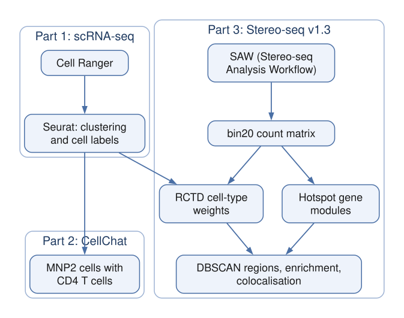

# sven_sammy

Analysis code of a mouse liver study (Haque Lab, University of Melbourne): single-cell RNA-seq of liver
CD4 T cells and mononuclear phagocytes (MNPs), ligand-receptor analysis with CellChat, and Stereo-seq v1.3
spatial transcriptomics of a liver section analysed with RCTD, Hotspot and DBSCAN.

## Contents

| Folder | What it does | Main scripts |
|---|---|---|
| [`1_scRNAseq_preprocessing_clustering_annotation/`](1_scRNAseq_preprocessing_clustering_annotation) | Cell Ranger, clustering and cell labels of the scRNA-seq data | `0_make_GEX_HTO_Processed.R`, `liver_scRNAseq_processed_NI.R`, `sven_liverscRNAseq.R` |
| [`2_CellChat/`](2_CellChat) | Ligand-receptor communication of MNP2 cells with infected or cytotoxic CD4 T cells, compared with naive CD4 T cells | `run_cellchat_MNP2_infected_vs_naive_CD4_latest.R`, `run_cellchat_MNP2_cytotoxic_vs_naive_CD4_latest.R` |
| [`3_STOmics_liver_v1.3/`](3_STOmics_liver_v1.3) | RCTD deconvolution, Hotspot gene modules, DBSCAN regions, cell-type enrichment and colocalisation | `rctd_script_NI.R`, `hotspot_liverstomics_NI.ipynb`, `liverstomics_hotspot_dbscan_NI.R` |
| [`environment/`](environment) | Conda environments (Python) and install scripts (R libraries), with test results | [`environment/README.md`](environment/README.md) |
| [`docs/PROVENANCE.md`](docs/PROVENANCE.md) | Origin of every file and differences between saved scripts and results | |

## Reproduce

1. **Data.** The input data are not in this repository. [`DATA_NOT_IN_REPOSITORY.tsv`](DATA_NOT_IN_REPOSITORY.tsv)
   lists every input and intermediate object on Spartan (20 November 2026) with its size and md5 (not
   computed for FASTQ files and folders).
2. **Environments.** Create the two conda environments (Python) and three R libraries of
   [`environment/README.md`](environment/README.md). Rebuilt from scratch and run on the original data, they
   reproduced the compared results, most of them byte for byte; the Hotspot tables change slightly in every
   run.
3. **Run.** Follow the "Run" section of each part's README. The scripts contain absolute paths of the
   Spartan cluster (University of Melbourne); edit them first. Several scripts were written for
   interactive use and are run section by section.

## About the files

- The analysis scripts and results are byte-for-byte copies of the files on the lab's storage on Spartan
  (copied on 20 November 2026), not edited for this repository; four files were recovered from editor records
  and session logs instead. Six scripts were saved again by their author after the results were produced; the
  differences found (for example `n_neighbors` in the Hotspot notebook) are noted in the part READMEs.
  [`MANIFEST.tsv`](MANIFEST.tsv) lists the origin, owner, date and md5 of each file.
- Added for this repository: the READMEs, `docs/`, `environment/`, `MANIFEST.tsv`, `DATA_NOT_IN_REPOSITORY.tsv`
  and two standard scripts of part 1 (`1_cellranger/run_cellranger.sh`, `0_make_GEX_HTO_Processed.R`).
